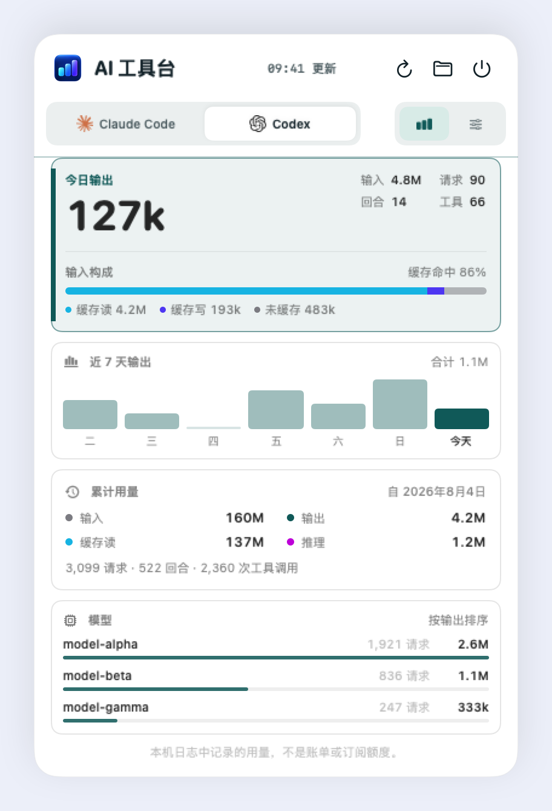

# AI 工具台 / AIToolbox

<p align="center">
  
</p>

macOS 菜单栏应用：把 Codex 与 Claude Code 的本地用量、趋势和供应商配置收进
一个原生面板。数据全部来自本机日志，不查询任何远端账单或订阅额度。

Swift 6 编写，无外部 SPM 依赖，要求 macOS 13+。

## 界面

| 用量详情 | 供应商配置 |
| --- | --- |
|  |  |

暗色模式同样适配（`docs/images/detail-dark.png`、`docs/images/config-dark.png`）。

## 构建与测试

```bash
swift build
swift test
```

包产物为可执行 target（`AIToolbox`），界面资源随包打包。

## 打包

```bash
bash scripts/package-app.sh
```

生成 .app 产物用于安装（如装入 `/Applications`）。脚本未设可执行位，用
`bash` 显式运行。
