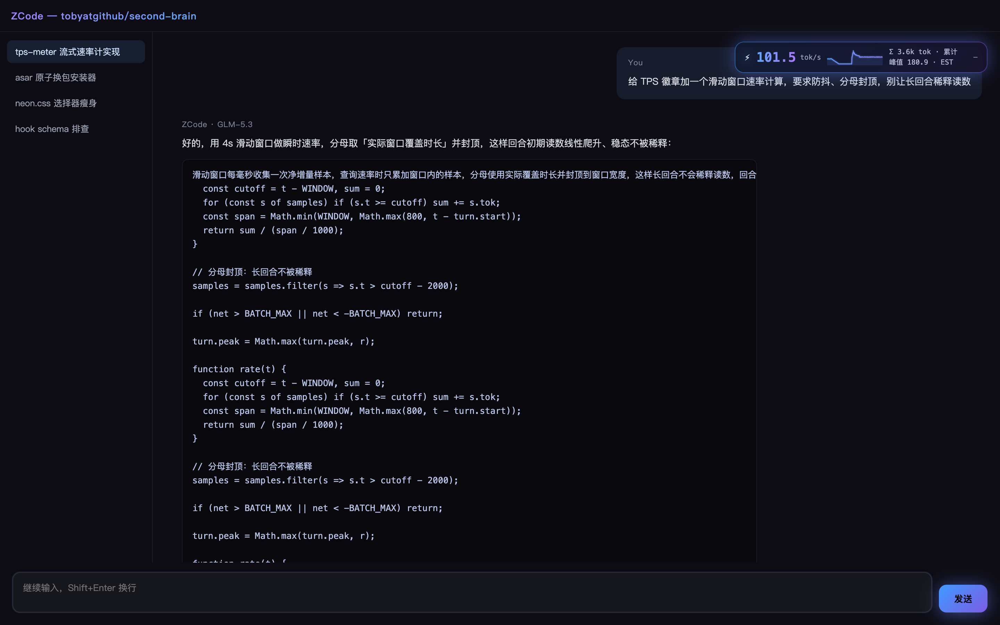
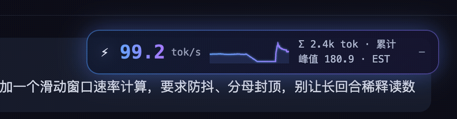

# ZCode UI Enhancer (macOS Edition)

非官方 **ZCode 桌面端（macOS）** 渲染层增强工具：**tok/s 输出速率计 + 霓虹主题包**。
通过把注入块合并进 `app.asar` 的渲染入口实现，纯本地、不改动任何业务逻辑。



> **致谢 / Credits**：本项目 fork 自 [Rick_ZhangR1/zcode-ui-enhancer](https://gitee.com/Rick_ZhangR1/zcode-ui-enhancer)（Gitee），基于原版的注入架构与 tps.js 速率计做了 macOS 移植与裁剪。感谢原作者的出色工作！
> This project is forked from [Rick_ZhangR1/zcode-ui-enhancer](https://gitee.com/Rick_ZhangR1/zcode-ui-enhancer) with macOS support. All credit for the original injection architecture and the TPS meter goes to the original author.

> ⚠️ 非官方修改。注入会对 `app.asar` 做物理改写；保留 `app.asar.old_v2` 可一键回滚。本工具不分发 ZCode 的任何官方资源。

## 与原版的差异

| | 原版 (Windows) | macOS Edition |
|---|---|---|
| 安装器 | Windows 专用（.bat watcher 处理文件锁） | 原子换包：macOS 无文件锁，`os.replace` 一步到位，无需 watcher |
| TPS 速率计 | ✅ | ✅ 原样保留（9 项单测全过） |
| 霓虹主题包 | 与壁纸/半透明面板耦合，覆盖 13 个官方 `--color-*` token | 纯装饰层独立成 `neon.css`，不碰任何官方 token，抗升级 |
| 壁纸 / 半透明面板 / 彗星尾 | ✅ | ❌ 裁剪（版本耦合深 + 口味取舍） |
| 升级后恢复 | 手动重装 | **SessionStart hook 自动重装**（见下） |

## 功能

| 模块 | 说明 |
|---|---|
| TPS 速率计 | 常驻右上角徽章：⚡输出中/💤休息；实时 tok/s + 累计总量（只增不减，切换对话零影响）；点击展开 30s 曲线 + 累计/峰值面板 |
| 霓虹主题包 | 蓝紫渐变主按钮/滚动条/卡片描边/流光标题/呼吸光（深色模式下生效） |

徽章运行实况（demo 页 + 无头浏览器实录，见 `demo/`）：



## 安装

依赖：`python3`（macOS 自带即可）与 `node`/`npx`（用于 asar 解包打包）。

```bash
git clone https://github.com/tobyatgithub/zcode-ui-enhancer
cd zcode-ui-enhancer
python3 install.py                # 安装注入
python3 install.py --install-hook # 安装升级自动重注入 hook（推荐）
# 重启 ZCode 生效
```

查看状态 / 回滚：

```bash
python3 install.py --status
python3 install.py --uninstall    # 回滚到官方包
python3 install.py --remove-hook  # 移除自动重注入 hook
```

## 升级后自动恢复（hook 的原理）

ZCode 每次升级都会用官方包覆盖 `app.asar`，注入随之丢失。本项目的解法：

1. `--install-hook` 在 `~/.zcode/cli/config.json` 注册一个 **SessionStart hook**，并把安装器快照到 `~/Library/Application Support/zcode-ui-enhancer/`（仓库目录挪走也不影响）。
2. ZCode 升级后你第一次打开它，会话启动时 hook 自动检测注入标记，丢了就在**后台**重新解包→合并→原子换包，完成后弹系统通知。
3. 重启 ZCode 即恢复增强版。全程无需手动执行任何命令。

**为什么不是 launchd 守护进程？** macOS 的 App Management 保护（TCC）禁止非授权进程写入 `/Applications` 下的 app bundle——实测 launchd 拉起的进程对 bundle 内任何写操作都会 `EPERM`。而 ZCode 会话内派生的进程继承 ZCode 自身的授权，可以写 bundle。所以检测点放在会话启动处，权限刚刚好。

## 让 AI 帮你装（复制粘贴给 ZCode）

```text
请帮我安装 zcode-ui-enhancer：
1. git clone https://github.com/tobyatgithub/zcode-ui-enhancer 并进入目录
2. 运行 python3 install.py，再运行 python3 install.py --install-hook
3. 运行 python3 install.py --status 确认注入状态为"已注入"
完成后告诉我重启 ZCode。
```

## 升级兼容性检查（可选）

ZCode 大版本升级后若担心样式层变化，可用原作者的兼容性分析方法论先体检：

```bash
python3 update/analyze_ui_compat.py <旧版解包目录/out/renderer> <新版解包目录/out/renderer>
# 关键：CSS 文件名(styles-*.css)是内容哈希，同名=样式层未变，可放心沿用注入
```

## TPS 速率计的计数原理

- MutationObserver 监听整个 body；CJK≈1 tok/字、英文≈4 字符/tok（估算，徽章标 EST）。
- 统计口径为**累计总量**：Σ 自 ZCode 启动起只增不减、不按对话切分；切换会话时新旧消息的 DOM 拆建由对称批次闸门（|净增|>100 tok 视为加载/卸载，忽略）整体过滤。
- 防误计：净增量统计（删旧插新抵消，重渲染不计）、徽章自刷新跳过、React 注释节点不计、孤立小突变（<5 tok）不点亮、输出结束 10s 冷却期内的小增量不重新点亮。
- 速率 4s 滑动窗口，分母封顶 4s（防回合越长越被稀释）；输出停止时数字冻结在末帧，不回落 0.0。
- **可见性边界**：MutationObserver 只能看到当前渲染出来的内容——多会话并行时仅统计前台会话的输出，后台会话不计入；独立多窗口则各有自己的徽章。要全量统计请走 CLI 层的会话数据。
- 单测：`node tests/test-logic.js`（9 项，注入前后的 tps.js 逻辑均可独立验证）。

## 目录

```
inject/
  neon.css           # 霓虹主题包（<style> 注入）
  tps.js             # tok/s 速率计（<script> 注入，原样继承自原版）
install.py           # 安装/回滚/hook 管理（解包→合并→打包→原子替换）
update/analyze_ui_compat.py  # 升级兼容性分析（原作者方法论）
tests/test-logic.js  # TPS 计数逻辑 9 项单测
demo/               # README 配图生成（demo 页 + 无头浏览器截图，零依赖借系统 npx）
```

## License

MIT。继承原版 [Rick_ZhangR1/zcode-ui-enhancer](https://gitee.com/Rick_ZhangR1/zcode-ui-enhancer) 的 MIT 授权，版权信息见 [LICENSE](LICENSE)。

---

**English (short)**: Unofficial renderer-layer enhancement for the ZCode desktop app on macOS — a tok/s output-rate meter and a neon theme, injected into `app.asar`. Forked from [Rick_ZhangR1/zcode-ui-enhancer](https://gitee.com/Rick_ZhangR1/zcode-ui-enhancer) (Gitee, Windows edition). This edition adds an atomic-swap installer, slims the theme to a version-resilient decoration layer, and auto-reinstalls after ZCode upgrades via a SessionStart hook (a launchd daemon cannot write into app bundles under macOS App Management protection). Unofficial — use at your own risk; MIT licensed.
