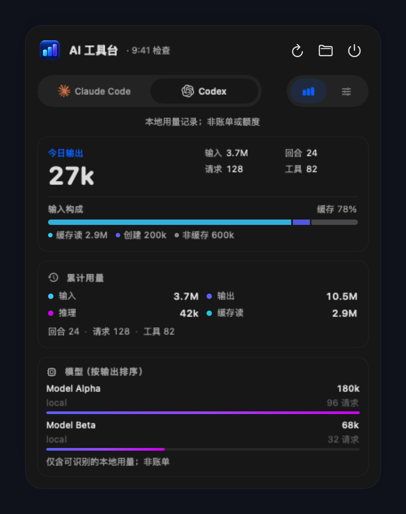
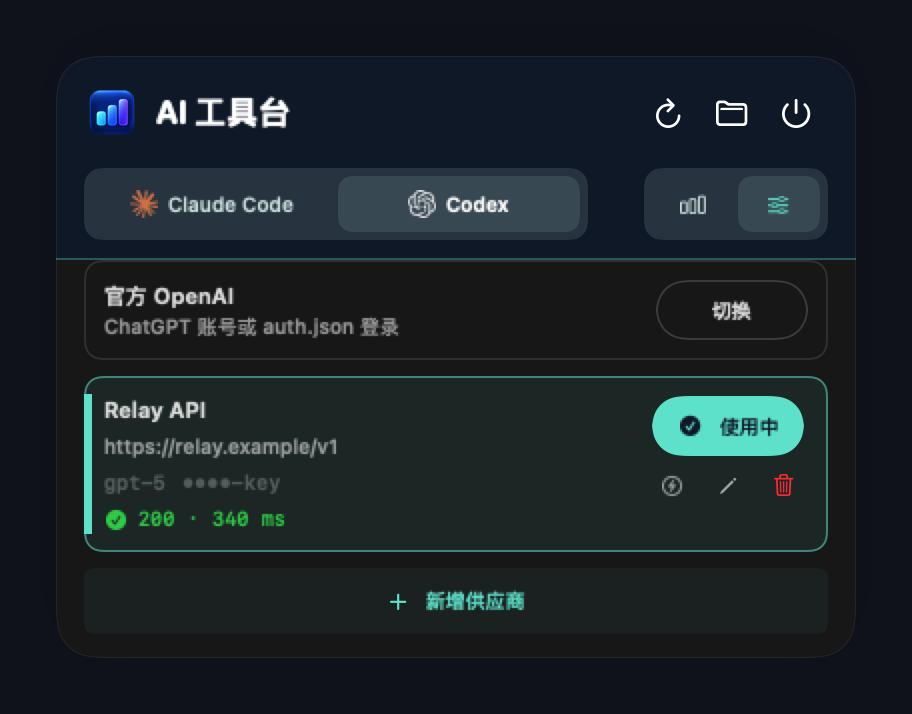

<h1 align="center">AI 工具台 · AI Toolbox</h1>
<p align="center">把 Codex 与 Claude Code 的用量和供应商配置，放进菜单栏的一角。</p>
<p align="center"><strong>macOS 13+</strong> · SwiftUI · 本地数据 · MIT</p>


<p align="center">
  <a href="#快速开始">快速开始</a> ·
  <a href="#界面预览">界面预览</a> ·
  <a href="docs/data-sources.md">统计口径</a> ·
  <a href="#开发与验证">开发与验证</a>
</p>

AI 工具台是一个 macOS 菜单栏应用，集中展示 **Codex** 与 **Claude Code** 的今日输出、累计 token、缓存用量和模型排行，并可在配置面板里切换、增删改供应商。数据来自本机记录，无需额外登录。

## 一眼看到需要的信息

| 功能 | 使用体验 |
| --- | --- |
| 菜单栏用量 | 常驻显示当天已记录输出，点击展开详情 |
| 两个工具，一个面板 | Codex / Claude Code 标签切换用量与配置，选择自动保存 |
| 今日与累计 | 输出、输入、缓存及来源支持的活动指标，分别展示 |
| 安静地后台刷新 | 每 30 秒刷新，各来源独立读取；支持刷新按钮和 `⌘R` |
| 清楚的数据状态 | 区分加载、读取失败和部分数据，失败时保留上次成功结果 |
| 供应商切换 | 保存供应商库、切换当前生效的 Base URL / 模型 / API Key |
| 模型列表 | 切到自定义供应商时，把该供应商的模型发布进 Codex 的模型选择列表 |
| 原生深浅色 | 自适应系统外观，清晰卡片、语义色与独立应用图标 |

## 界面预览

<table>
  <tr>
    <td align="center"><strong>浅色 · 用量</strong></td>
    <td align="center"><strong>深色 · 用量</strong></td>
  </tr>
  <tr>
    <td></td>
    <td></td>
  </tr>
  <tr>
    <td align="center"><strong>浅色 · 配置</strong></td>
    <td align="center"><strong>深色 · 配置</strong></td>
  </tr>
  <tr>
    <td></td>
    <td></td>
  </tr>
</table>

<sub>界面截图使用示例数据。</sub>

## 快速开始

需要 **macOS 13+** 和 **Xcode / Swift 6**。使用系统 SwiftUI 与 AppKit，无第三方 Swift 包依赖。

```bash
git clone https://github.com/cookabc/ai-toolbox.git
cd ai-toolbox
swift test
bash scripts/package-app.sh
open dist/AIToolbox.app
```

应用启动后显示在 **macOS 菜单栏**，不会出现在 Dock 中。

打包脚本生成本地 ad-hoc 签名应用，未做 Apple 公证。若 macOS 阻止打开，请确认构建来源，并按系统提示允许打开。

## 如何理解数字

- **`0`**：该指标在所统计的记录中为零。
- **`—`**：指标不支持、字段不完整，或今日数据尚未更新。
- **部分**：存在来源缺失、读取失败或无法确认用量的记录。
- **今日**：按 macOS 本地日期统计，跨日后未更新的旧快照不计入今日。
- **累计**：当前可读取的本地历史记录，日志删除或迁移可能影响范围。

这些数字是 **本机已记录用量**，不是厂商账单或订阅剩余额度。

| 来源 | 读取位置 |
| --- | --- |
| Codex | `~/.codex/sessions`、`~/.codex/archived_sessions` |
| Claude Code | `~/.claude/projects`，包括 subagents |

去重规则、缓存语义与日志限制详见 [数据来源与统计口径](docs/data-sources.md)。

## 本地数据与读取边界

用量统计不上传会话内容，也不向源数据库写入业务数据。日志逐行处理，不保留会话正文或工具参数。

**供应商库**保存在 `~/Library/Application Support/AIToolbox/providers.json`。配置面板会读写当前生效文件：`~/.claude/settings.json` 的 `env` 覆盖项，以及 `~/.codex/config.toml` 的 `model` / `model_provider` / `[model_providers.*]`。API Key 留在这些本机文件中，界面默认掩码；写入前会在同目录留下 `.ai-toolbox.bak`。不修改 `~/.codex/auth.json`。

自定义供应商生效时，面板还会写一份 `~/.codex/ai-toolbox-models.json`，并把 `config.toml` 的 `model_catalog_json` 指向它——Codex 的模型列表只认这份目录，不写就没有该模型，还会提示缺少元数据。目录条目必须自带系统指令，因此指令逐字取自 Codex 自己下载的官方目录（`~/.codex/models_cache.json`）；官方条目在发布时被标记为不进列表，仍可按名字解析，子代理与自动审查不受影响。切回官方 OpenAI 时会同时移除该键与文件；手工设置的 `model_catalog_json` 不会被覆盖。（该行为在 Codex 0.155 上验证；更早的版本会把 `model_catalog_json` 当成未知字段并忽略。）

首次读取或历史记录较多时，扫描可能需要一些时间，期间可切换到另一工具。

## 开发与验证

```text
Assets/       应用图标及生成提示词
Sources/      SwiftUI 界面、数据来源与刷新逻辑
Tests/        聚合、去重、缓存、异常和状态测试
scripts/      macOS 应用打包
docs/         统计口径与界面截图
```

```bash
swift test                          # 默认使用合成数据
swift build -c release              # 编译 release 二进制
bash scripts/package-app.sh        # 打包并验证签名
```

按需读取本机真实记录：

```bash
USAGE_LOCAL_SMOKE=1 swift test --filter MultiProviderTests/testLocalSourcesWhenExplicitlyEnabled
```

重新生成 README 截图，不读取本机会话：

```bash
USAGE_RENDER_DOCS=1 swift test --filter DocumentationRenderTests
```

会更新 `docs/images/` 下的 `hero.png`、`detail-*.png` 与 `config-*.png`。

## License

[MIT](LICENSE)。
